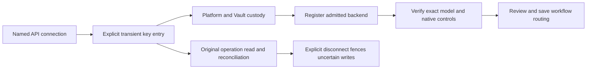

# Model Operations Live Integration

Status: implemented source boundary; runtime activation remains subject to the
exact Security decision and Platform composition.

## Operator Outcome

Model Operations exposes two jobs in the existing Compact Control surface.
**Models & routing** submits operator choices for admitted backend/model
registration, native effort, system defaults, per-workflow overrides and ordered
fallback. **Purpose profiles** uses one form for purpose and permission requests, followed
by a separate result dialog. OOS coordinates both workflows; Platform
owns configuration, verification, profile source and provider credentials.
Security acceptance and runtime activation remain with their existing owners.

Models & routing retains its existing accepted runtime binding. The Purpose registry, request history and explicit review boundary were
introduced under Epic 1332. The current automatic-preparation maintenance
extension remains unpublished pending operator review, exact composed Security
acceptance and Platform commissioning. Source alone is not activation.

## Models & Routing Procedure

The overview uses the same compact summary/actions, register and selected-item
layout as other controls. **Manage registrations**, **Review routing** and
**Operation history** open focused views of the existing controls. Inspection
remains available when edits are blocked. Disconnected preview is explicitly
sample-only and cannot submit changes, connect accounts or create receipts.

### Experimental API connections

Epic1363 extends the same Models & routing surface with a connection dialog,
using existing Teras controls. Its owner workflow is:



Claude, DeepSeek and GLM/Z.AI Standard API remain **Experimental — real-account
testing pending**. Maturity is independent of health or a successful model probe.
No eligible provider accounts are available for this qualification. The existing
Codex/Ollama controls, defaults, task overrides, fallbacks and history remain.

Choose **API connections**, select the reviewed preset and a short name, then
explicitly enter its API key. Keys use a dedicated protected same-origin ingress
to Platform/Vault; they are never autosaved, included in advisor context, kept in
browser storage or passed through the generic model request journal. Closing or
changing connection clears unsent key material. Reload recovery stores only the
original safe command/reference and reads the authenticated owner again.

After an uncertain key write, check/reconcile the original operation. Never
automatically resubmit credentials. Disconnect clears stored credentials and
fences uncertain prior writes; reconnect requires a new key. Removing a connection
requires resolving its model/routing references first. A confirmed revision
conflict can be cleared after refresh and reviewed as a new command; uncertain
completion retains its original identity. Configuration restoration never
restores provider keys or retired connections. Current state is read
separately from an original operation's historical receipt.

GLM uses exact manual model entry because this preset has no admitted catalogue
API. Verification may consume up to 4,096 output tokens and 60 seconds. Native
controls come from provider metadata or documented protocol capabilities;
unknown controls use Provider default. Absent cloud runtime versions/digests are
shown as not supplied by the provider. Saved settings never restore credentials
or admission for removed connections; the owner rejects those stale references.

The additional same-origin routes are GET `/connections`, POST
`/connections/commands`, POST `/connections/credentials`, GET
`/connections/operations/{command_id}` and POST `/connections/reconcile`, all
under `/api/model-operations/runtime`. They retain the existing verified-session
and same-origin mutation guards. OOS owns workflow authorization and Platform
owns durable connection state and receipts. Source alone does not activate them.

### Existing registration and routing

1. Open Model Operations, **Models & routing**. The server reads admitted
   backends, current configuration and caller-owned history through OOS.
   First registration needs no prior completed request or lifecycle receipt.
   The existing OOS connection and verified operator session are sufficient
   Console-side configuration.
2. Open **Manage registrations**, then select and register an admitted backend. Where account sign-in is supported,
   choose **Connect account** and complete its native device challenge.
   The code is private operator metadata. Provider tokens stay in Platform
   custody and never enter Console configuration or browser storage.
3. The registered-model list shows only models on the selected backend, with
   its own search and count. Select a row to verify/update that registration or
   remove it; the owner checks route references before removal. To add a model,
   choose **Register model**, then **Discover models**, select an unregistered
   advertised model, then **Verify &
   register model**. Discovery is metadata. Registration completes after the
   Platform verification and receipt readback. GLM uses exact manual model entry
   in the same form. Adding a model does not change the selected registration.
4. Return to Models & routing, select **System default** or a workflow row and
   open **Review routing**. Configure an explicit model
   route, use the existing profile binding, or inherit the default for that
   workflow. Native effort choices come from registered model metadata.
   Boolean thinking values remain booleans. Unsupported combinations cannot
   be saved. The system does not rank models or impose a provider preference.
5. Add up to four explicit fallbacks in the required order. Eligible fallback
   is limited to known pre-submission unavailability/busy. Ambiguous completion,
   policy, integrity and output failures stop with owner evidence.
6. Save reviewed settings. The request retains the observed configuration
   revision. Concurrent edits require reload and review; the Console never
   silently changes the original expected revision. Dirty drafts are protected
   on scope change, view change and workspace close.
7. Inspect progress and the actual owner outcome. After a lost acknowledgement,
   check or reconcile the original request. A known effect-free failure allows
   an explicit numbered retry. Unknown completion keeps the original owner
   command. Reload recovery retains only a request reference and reads the
   authenticated owner again. Paginated history is available independently.
8. Cancellation reports only the owner's confirmed outcome. To restore saved
   settings, review a retained configuration revision and confirm restoration;
   Platform creates a new revision.

The closed same-origin adapter routes are:

- GET /api/model-operations/runtime/registry
- GET /api/model-operations/runtime/catalogue?backend_id=...
- GET and POST /api/model-operations/runtime/requests
- GET /api/model-operations/runtime/requests/{request_id}
- POST /api/model-operations/runtime/requests/{request_id}/controls

Reads and writes require the verified operator session. The browser cannot
choose owner addresses, caller credentials, roles or policy permissions.
API keys use only the explicit transient ingress above. Server validation binds operator, request, command and
receipt digests, accepted historical readback, native login and terminal state.
Owner failure is unavailable without fixture substitution.

Existing Work Design, Refinement, Agent Console and source-authoring consumers
accept optional, strictly task-bound effective-selection evidence. Legacy
records remain readable. Task outputs, context admission, source-policy
bindings and operator acceptance retain their existing contracts.

## Server-Only Configuration

Configure the existing OOS connection and operator/session boundary:

- `OOS_BASE_URL`
- `OOS_CALLER_ID`
- `OOS_CALLER_SECRET`
- `GOVERNANCE_CONSOLE_OPERATOR_ID`
- `GOVERNANCE_CONSOLE_SESSION_PROJECTION_PATH`

For **Purpose profiles**, mount the accepted current Platform registry projection
as an operator-private regular file and set:

- `GOVERNANCE_CONSOLE_MODEL_PROFILE_SOURCE_PROJECTION_PATH`

First use requires no previous receipt or completed request. Registry and
request-path status never assert historical transaction completion. For
fulfillment verification, set `GOVERNANCE_CONSOLE_MODEL_PROFILE_REQUEST_HISTORY_ROOT`
to the Platform-published directory owned by the Console process, mode `0700`.
Each immutable `0600` regular file is named by the SHA-256 hex digest of the
UTF-8 request id plus `.json`. Its version-1
`platform-model-profile-request-evidence` bundle contains exactly
`schema_version`, `artifact_type`, `request_id`, `lifecycle_receipt`,
`merged_readback` and canonical `digest`. Nested artifacts retain their own
digests and original source snapshot. Missing selected history never falls
back to another request's evidence.

The older `GOVERNANCE_CONSOLE_MODEL_PROFILE_LIFECYCLE_RECEIPT_PATH` and
`GOVERNANCE_CONSOLE_MODEL_PROFILE_MERGED_READBACK_PATH` pair remains a bounded
compatibility input when no history root is selected. It proves only the exact
matching request and is unnecessary for registry loading. Reads retain the
512 KiB, ownership, privacy, no-symlink, digest, Platform actor and request /
revision / source-binding checks. Receipt URIs and browser input are never
followed as local paths. Partial live configuration never falls back to fixtures.

## Purpose Profile Console Path

1. Open Operation Workbench, then Model Operations.
2. Confirm the workspace status is `Current` and inspect the Platform-projected
   profile register.
3. Select `Request Profile`.
4. Choose the registered workflow and enter the profile name, purpose and reason.
   Confirm the environment and most sensitive data; add optional operating rules.
   Registered integration references are supplied by the system. A new integration
   maintainer can use the explicit technical setup path instead.
5. Inspect technical details if needed. Missing workflow setup is shown explicitly;
   refresh it before submitting rather than inventing references.
6. Submit the single form and read its separate recorded outcome.
7. Inspect the OOS receipt. `submitted` means the request entered review; it
   does not mean Platform fulfillment, Security acceptance, or activation.
8. Open **Manage Requests** and select the original request, or choose
   **Find by reference**, enter its reference and select **Read original request**. Inspect its complete intent,
   requirements, owner next move and receipt history. Register polling cannot
   replace the selected scope.
9. Choose the review action offered by current OOS state. Explicit approval
   and rejection require a reason and decision reference/digest. Requested
   changes have typed requirements with owners and next moves. **Revise intent**
   reuses the original typed form and identity; saving is separate from
   resubmitting. Existing multiple-environment scope is displayed and retained.
   The same bound operator may submit and explicitly review its caller-owned
   request; Platform fulfillment uses a distinct caller.
10. Approval waits for the existing Platform fulfillment and Gary source-authoring
    path. It does not edit the registry, select a model, grant credentials,
    accept Security risk or activate runtime access. Refresh the original
    record to read its actual owner outcome.
11. After approved/applied, choose **Verify implementation**. Completion
    requires this request's original lifecycle receipt, merged readback and
    current OOS record. Its historical merged source is shown separately from
    today's registry; later changes cannot invalidate an earlier completed request.

The browser calls only the same-origin routes:

- `GET /api/model-operations`
- `POST /api/model-operations`
- `GET /api/model-operations/requests/{requestId}`
- `POST /api/model-operations/requests/{requestId}` (bounded operator review)
- `GET /api/model-operations/operating-projection/{requestId}`

The server holds OOS credentials, adds the verified operator identity, rereads
each listed request through its canonical source envelope, validates Platform
artifacts, and returns only browser-safe projections.

## Reconciliation And Completion

The operating projection returns `complete` only when all of these agree:

- the exact OOS request is approved and its fulfillment is applied;
- the OOS item read is current, ordered, caller-owned, and receipt-bound;
- the Platform lifecycle receipt names the request and pre-apply revision;
- the merged readback binds that lifecycle receipt and merged source revision;
- the historical source snapshot is byte-equivalent to its readback projection
  and policy digests match the lifecycle receipt's result source;
- the OOS fulfillment result version and receipt reference match Platform;
- `profile_lifecycle_changed` remains false in OOS;
- `console_mutation_authority` remains false.

## Failure And Recovery

- `disconnected-preview`: no live configuration was selected. Fixture-backed
  inspection remains explicit and `Request Profile` stays disabled.
- `invalid` or `offline`: restore the missing OOS binding, verified Console
  session, or exact Platform artifacts, then refresh. Do not copy credentials
  into the browser or substitute fixture evidence.
- revision conflict: reread the OOS request and review the new authoritative
  revision before retrying.
- digest, privacy, source-version, replay, or owner conflict: replace the
  mounted evidence with a newly generated authoritative artifact. Do not edit
  an evidence file in place.
- partial create/submit: reuse the same request and idempotency identities; OOS
  returns the existing request or rejects conflicting input.
- lost create/submit acknowledgement: choose **Recover original request** or
  open its reference in Manage Requests. Submit a retained draft there; read
  an already submitted or fulfilled record as it is. Do not replace it.
- unknown review acknowledgement: retain the frozen command identity, time,
  expected revision and reviewed body. Read the original record or retry that
  exact action. A known rejection permits fresh review after canonical refresh;
  lost acknowledgement never silently changes the command or revision.
- unavailable current registry: disable new requests without inferring profile
  state. Manage Requests can still read an original record independently.
  Historical verification never uses today's registry as old completion evidence.

## Validation

Run:

```bash
npm run architecture:model-operations
node --disable-warning=MODULE_TYPELESS_PACKAGE_JSON --experimental-strip-types --test --test-concurrency=1 tests/model-operations/*.test.mjs
npm run typecheck
npm run build
```

The focused tests cover current projection, exact request submission, source
envelope consumption, private artifact validation, reconciliation, and
fail-closed malformed or incomplete evidence.

## Purpose Profile Source Availability

Purpose profiles uses accepted current Platform source and the live OOS request
path. Missing history affects only verification of its selected request.
Missing current source disables new requests and never infers lifecycle or
pending-selection facts from a sample or old transaction. Models & routing
retains its independently admitted live configuration.

Sample purpose profiles remain available only in the explicit wholly
disconnected design preview, which is labelled as sample data rather than
current Platform state. Partial, stale or invalid profile artifacts continue
to fail closed under the existing verification path.

## Provider health and registration updates

Core Console availability is independent of AI provider availability. After core
startup, Platform checks registered connections on its existing observation
timer; Models & routing reads cached, expiring evidence. A current local metadata
check is not a successful inference. Account presence is explicitly labelled
connection unprobed; routine checks never start Codex or send project context.
The primary health column follows the actual configured workflow route.

Select a registered model to inspect its accepted and observed runtime/digest.
Choose **Verify & update registration** to test the current advertised model and
accept a new registration revision only on success. This retains the model's
stable identity, routes and earlier evidence. Automatic checks never adopt drift,
choose defaults or change fallbacks. A failed/unknown check leaves configuration
controls available. Missing, invalid, expired or mismatched evidence is unknown.
Unknown command completion still reconciles its original owner operation.

This maintenance reuses the existing Compact Control, Teras table, metadata and
actions. Its [Security delta](https://github.com/mfshaf7/security-architecture/blob/main/docs/reviews/components/2026-10-30-provider-lifecycle.md) and normal Platform
acceptance remain required before runtime qualification.

Native visual qualification keeps the existing metadata pattern readable:
provider check time sits beneath provider status, model content is summarized as
changed/unchanged/unknown with full accepted/observed digests in the existing
metadata tooltip, and the original runtime values remain visible. The routing
form uses its existing bounded Field Stack scrolling so multiple fallback fields
retain their own space. No workflow, permission, verification or routing effect
changes in this presentation correction.

## Post-start connection and model evidence

Existing Models & routing distinguishes native connection metadata from actual
model success. The selected registration shows the last successful verification
or routed request with its original timestamp, receipt reference and recent/stale
label (15 minutes). A newer failure or changed registration keeps verification
required. No timestamped evidence means Verification needed, including legacy
registrations whose original receipts had no timestamp. Core startup and Console
reads do not dispatch inference or change model registration.

Landing Unit Decision: feature_single_landing_unit, operator-approved maintenance
`maintenance-provider-health-governance-operations-console-20261030`.

### Pending maintenance preview: clarity and recovery

The unpublished Model maintenance preview keeps the existing native API,
Platform source schema and review authority. Policy summaries explicitly
distinguish activation permission from provider health and invocation evidence.
Use **Models & routing** from the Profile Dashboard to inspect or choose model
settings. Routing defaults and overrides retain their existing enforcement.

To request a purpose profile, choose the registered workflow and describe its
purpose and usage. The system prepares its registered callers, admitted context
and output contract. Explicit technical setup remains available to integration
maintainers; recorded references must be reviewed for current applicability.
The form does not manufacture contract evidence. Approval or
rejection still requires the real recorded decision reference and digest.

Keep a pending submission open. If its response cannot be confirmed, use
**Check original request** or **Check request result** before another submission.
Only the original request ID is retained for browser recovery. Successful
readback clears that recovery reference. A failed source refresh disables
profile actions until **Retry** returns current authoritative evidence.

For an API provider, create a named connection, store its key, then use
**Continue to model registration** for that exact connection. Register the
connection if required, verify the desired model and choose workflow routing.
This does not change provider qualification: experimental presets still need
real-account verification before broader operating claims. API keys are never
included in profile drafts, browser recovery references or advisor input.


### Single-form request preparation

Open **Request Profile**, choose the registered workflow and enter the profile
name, purpose and reason. Confirm the environment and most sensitive data; add
extra rules only when needed. There is no separate review page in this form.
The real request-review and activation decisions remain later actions.

The server reads the current Platform workflow setup. It supplies the responsible
repository, registered caller bindings and the output schema with its actual
owner digest. On submission, OOS admits the request context through the existing
CGG text-admission API and uses that returned artifact reference and digest in
the native profile request. Neither the browser nor an advisor invents those
coordinates. The normal form exposes these values through Technical details,
not required raw inputs. Workflow setup changes require an explicit refresh and
review before resubmission; changing providers does not invalidate unchanged
workflow setup.

A failed setup read shows Retry. A proven pre-create preparation rejection
keeps the same editable draft and ID. An uncertain transport or native operation
retains original-request recovery. The separate result dialog names the recorded
review and implementation states, links to the original request and does not
claim approval or activation. Pending requests cannot close or double-submit.

**New integration — technical setup** preserves the existing full-reference
path for integration maintainers and workflows that are not registered yet.
It is not the ordinary requester path. Revisions retain their original supporting
references; maintainers can explicitly edit technical setup when the reviewed
change requires it. Requested changes can be revised and submitted for review
through the existing native review actions.

Automatic preparation requires the separately accepted Platform metadata
producer and OOS preparation configuration. It is optional and disabled by
default until commissioning; unavailable preparation never substitutes samples.
Disconnected preview alone provides labelled sample choices and results with
all real submit/review/account/key effects disabled.

### Request history layout

**Manage Requests** presents original Request details and Review side by side,
with Request events below. Select a human-labelled recorded request, or use the
secondary **Find by reference** lookup. Explicit lookup can read an original
request outside the current register list; its identity stays selected.

**Review action** starts at **Choose an action**. Only the existing native
transitions are offered. Approval and rejection still require the actual saved
decision record reference and SHA-256 digest; the Console does not create this
evidence or infer a decision. Successful commands show **Review recorded** and
the authoritative updated states/events. Unknown outcomes retain the original
frozen command and read/retry recovery. Implementation verification is available
when the original request is approved and applied.

Event names and UTC timestamps are readable; each event retains its original
summary, order, actor, exact timestamp, command, resulting states and receipt
reference/digest under **Event details**. A source with no history shows an
explicit empty state rather than an invented event. Technical details also retain
the original request and any recorded decision references. The modal uses the
standard scroll region and pinned return action; review and revision remain
disabled in the labelled disconnected design preview.

### Bounded history and retained outcomes maintenance

The Purpose profile register reads its current Platform source independently.
It does not enumerate profile requests on the15-second register poll. Opening
Manage Requests loads25 caller-scoped summaries through the existing OOS list
with `view=summary`; Previous and Next retain native cursors. Full current
evidence is read only for the selected request, including direct reference
lookup outside the visible page. Page failure offers Retry without clearing the
profile register or an independently loaded original request. Summary rows are
selection metadata, never mutation authority. The technical request form uses
the same bounded picker and reads the selected original before filling setup.

Changing records or reading another reference requires explicit discard when
review text, evidence or requested changes are unsaved. Merely typing a lookup
reference does not change the active review. Uncertain accepted commands retain
their original recovery path. Connection operations retain confirmed receipts
when later current-state or model-register reads fail; those read errors are
reported separately and edits remain blocked until current source is available.

The native private JSON store still verifies and reads its state once per
requested page. This removes automatic history polling, event-body projection
and per-row detail fan-out; it does not claim an indexed storage backend or a
frozen snapshot across independently requested pages. Existing-profile lifecycle
coverage remains a separate design checkpoint.


## Purpose-profile lifecycle maintenance

**Change profile policy** in the selected profile dashboard is the staged normal
path for the native six intents. It shows owner-computed impact before submission
and asks for meaningful policy limits, data sensitivity and a reason. The browser
cannot author an arbitrary target, choose a checkout, supply a source digest or
execute commands. Create/amend suspend policy; request wording is metadata.

History records approve/reject with its reason as a real OOS decision artifact.
Separate explicit Security acceptance appears only for activation/exception and
can be recorded only by an admitted operator. Approval, source implementation
and running verification remain separate. Platform implementation shows the
exact Gary PR/head, requires explicit human review/merge, and preserves original
operation recovery, real progress/events, unverified outcomes and exact receipt
rollback. Confirmed source application is not erased by a later runtime failure.
A rollback is itself reviewed source and cannot overwrite later policy drift.

All lifecycle mutations use existing Console session authorization and server
custody. Existing externally referenced review commands remain a recovery API,
not a form requirement. Source operation failures retain original identity;
read/retry does not silently create another request or decision. No advisor or
AI model can accept final review or Security decisions. Disconnected preview
labels source checks and mutation as unavailable rather than inventing effects.

The producer flags remain disabled pending paired source and composed runtime
acceptance. Qualify a disposable profile and interruption/negative paths after
landing; preserve current working profiles. Current source/browser conformance
is not evidence of live activation.

## Permission profiles for installed Console AI Capabilities

The maintenance preview extends the existing controls. A Console AI Capability is an
implemented integration such as Agent Console, Work Design or Refinement. It is
not an ART Feature or a user-authored workflow definition. Its guide explains
behavior, accepted input, returned output and where instructions are implemented.
Changing a request description or reviewer notes does not write those instructions.
A new capability requires implementation, tests and registration by its source
maintainer before it appears as a normal selectable integration.

An installed capability can have several named permission profiles. Create one
from its registered setup, set permitted-input rules and supported operating
limits, and submit it through the existing request/review/source path. The result
is suspended and unselected. Activation needs the separate Security decision.
Then use **Models & routing → Permission profiles** to explicitly select its
active profile. The current model-configuration revision guards that selection;
progress, uncertain completion and recovery use the same original operation.
Selecting a profile does not register a model or change its reasoning effort.

The stable base profile still authorizes the capability's caller, admitted
context and response contract. The selected profile is an additional restriction.
Both policies must permit a request. Free-text data-scope notes document reviewed
policy; they do not author an access filter or new task instructions. Actual
context access remains enforced by the registered integration and CGG. Effective numeric limits cannot exceed the
base or provider ceilings. Managed requests never automatically retry a submitted
turn. Dedicated-account output uses a byte limit rather than a native token cap.
Model routing keeps the capability's stable task IDs. Effective selection and the
audit distinguish its base contract from the actually selected permission profile.
One captured configuration revision binds both policy selection and model routing;
replay after a configuration change cannot dispatch the original request again.

When review requests policy changes, use **Revise operating policy** on the same
request. It reads current source, checks impact, admits supporting context and
rebuilds the candidate before recording a revision. Prior Security acceptance is
cleared, and the revision must be resubmitted and reviewed. **Revise review
details** changes request wording only. Integration-reference changes cannot
silently discard a prepared candidate. Older manual requests remain readable,
but automatic implementation requires actual prepared policy rather than invented
references. Interrupted writes recover the same command and request identities.

Profile names and operating rules enter source review; request descriptions,
justifications, notes and private supporting context remain in operational
custody. Do not place project contents or secrets in published policy fields.
Loading is separate from unavailable or failed reads. Preview contains labelled
samples and cannot save selections, decisions or operating changes. These staged
extensions still require source review and exact composed operating acceptance.
